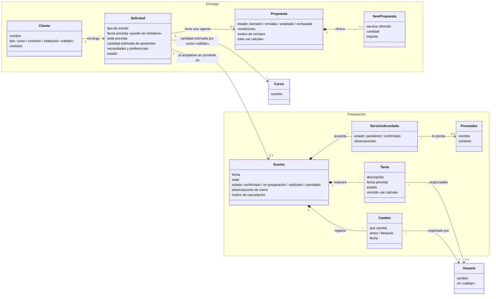

# Análisis y diseño orientado al dominio (DDD)

## Lenguaje ubicuo — lucas (SI-4)

| Término | Significado para la empresa | Ejemplo | Aclaraciones / no confundir con |
|---------|-----------------------------|---------|---------------------------------|

### Términos ambiguos aclarados

### Estados

| Concepto | Estados | Qué hace pasar de uno a otro | Quién |
|----------|---------|------------------------------|-------|

### Reglas de negocio

| Regla | Origen (conversación) | Cómo la valida el software |
|-------|-----------------------|----------------------------|

## Subdominios y bounded contexts — masita (SI-5)

> **Versión 0 — comprensión inicial a partir del documento de alcance.**
> Todavía no hay relevamiento con el cliente: todo lo que dice **(validar)** es hipótesis y se
> corrige con lo que confirme el ChatGPT‑cliente. La consigna pide que el análisis evolucione:
> guardar esta versión y anotar después qué cambió y por qué.

### Subdominios

El dominio es **organizar eventos por encargo**: el centro de estudiantes recibe un pedido, acuerda
qué va a ofrecer y coordina a quienes lo hacen posible.

| Subdominio | Tipo | Por qué |
|------------|------|---------|
| **Acuerdo del encargo**: solicitud, propuesta, aceptación o rechazo | **Core** | Es lo que hace valiosa a la organizadora: entender el pedido y llegar a un acuerdo claro de qué se va a hacer y por cuánto. El objetivo del software es justamente "conocer qué se acordó" |
| **Coordinación de la preparación**: servicios acordados, proveedores, tareas, pendientes, cambios | **Core** | Es la otra mitad del objetivo: "quién debe hacer qué y qué falta resolver". Si se pierde un compromiso, el evento falla |
| **Catálogos**: tipos de evento, sedes, servicios ofrecidos, cursos | Soporte | Necesarios para trabajar, pero no diferencian a la organizadora; son listas que se consultan |
| **Acceso del personal**: usuarios, roles, organizadora (tenant) | Genérico | Cualquier sistema lo necesita y se resuelve igual en todos lados |

Fuera del dominio del software (lo hace la organizadora pero no lo soporta el sistema): venta de
tarjetas, lista de asistentes, cobros y pagos.

### Bounded contexts

Proponemos **dos contextos de negocio** más uno de soporte. El límite no sigue sectores de la
empresa ni componentes técnicos: sale de que **las mismas palabras cambian de significado** y de
que cada parte tiene **reglas distintas**.

| Contexto | Qué incluye | Pregunta que responde |
|----------|-------------|-----------------------|
| **Encargo** (comercial) | Cliente, Solicitud, Propuesta, Ítem de propuesta | ¿Qué pidió el cliente y qué le ofrecimos / acordamos? |
| **Preparación** (operativo) | Evento confirmado, Servicio acordado, Proveedor, Tarea, Cambio | ¿Quién hace qué, qué está confirmado y qué falta? |
| Organización y acceso (soporte) | Organizadora, Usuario, Rol, catálogos | ¿Quién puede usar el sistema y con qué datos base? |

**Por qué separar Encargo y Preparación:**

1. **"Servicio" significa cosas distintas.** En *Encargo* es algo **ofrecido con un importe**
   ("DJ — $180.000"). En *Preparación* es un **compromiso con un proveedor** que está pendiente o
   confirmado ("DJ Nacho Beats — confirmado"). Mismo nombre, otro concepto y otras reglas.
2. **"Evento" cambia de naturaleza.** Antes de aceptar la propuesta es un **pedido en negociación**
   (puede cambiar todo, puede rechazarse). Después es un **compromiso** que se ejecuta.
3. **Reglas distintas.** En *Encargo*: una sola propuesta vigente, total = suma de ítems,
   aceptación o rechazo con motivo. En *Preparación*: estados de proveedores y tareas, vencimientos,
   y revisar compromisos afectados ante un cambio.
4. **Personas distintas (validar).** Probablemente negocia una persona (comisión directiva) y
   preparan otras (colaboradores con tareas).

**Cómo se relacionan:** cuando la propuesta se **acepta**, el contexto Encargo le pasa a Preparación
los servicios acordados y las condiciones. A partir de ahí, Preparación los convierte en
compromisos con proveedores y tareas. Un **cambio relevante** (fecha, servicio) vuelve a involucrar
a Encargo si afecta lo acordado **(validar cómo lo tratan)**.

> La base de datos es una sola (BD): los contextos son una forma de **entender** el dominio y
> mantener el lenguaje claro, no tablas ni servidores separados.

### Modelo conceptual

**Relación con la base de datos:** en la BD, `Solicitud` y `Evento` son la **misma tabla**
(`eventos`, con estado), porque es el mismo encargo que avanza. En el modelo conceptual los
separamos para mostrar que **cambia de significado** al aceptarse la propuesta. Los dos modelos
son coherentes: el conceptual explica el negocio, el lógico decide cómo guardarlo.

### Pendiente de validar con el relevamiento

- [ ] ¿Quién es el cliente? (curso, comisión, institución) → afecta a `Cliente`
- [ ] ¿Negocian y preparan personas distintas? → refuerza (o no) la separación de contextos
- [ ] ¿Qué pasa con lo acordado cuando hay un cambio relevante?
- [ ] ¿Se usan los cursos para organizar o solo como dato?
- [ ] Estados reales de solicitud, evento, propuesta y tarea
