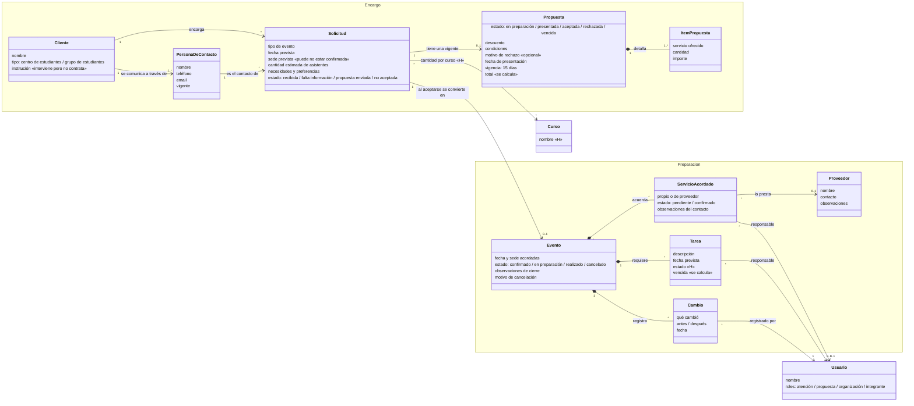

# Análisis y diseño orientado al dominio (DDD)

## Lenguaje ubicuo — acuerdos del grupo (SI-4)

> **Versión 1 · 14/10/2026** — armada a partir de la **ronda 1** del relevamiento y acordada por el grupo.
> Estos son los términos que usamos **todos**, en los documentos y en el código.
>
> Fuentes: **[M]** [charla de masita](relevamiento/conversaciones/2026-10-14-masita-clientes.md) (clientes y solicitudes) ·
> **[T]** [charla de Tomi](relevamiento/conversaciones/2026-10-14-tomi-propuesta.md) (propuesta y confirmación) ·
> **[F]** [charla de Facu](relevamiento/conversaciones/2026-10-14-facu-servicio-proveedores.md) (servicios y proveedores) ·
> **(H)** = hipótesis, falta confirmar en la ronda 2.

### Glosario

| Término | Significado para la empresa | Ejemplo | No confundir con | Fuente |
|---------|-----------------------------|---------|------------------|--------|
| **Organizadora** | La **empresa** que organiza eventos para centros de estudiantes. Sus integrantes son los únicos que usan el software | "Nuestra empresa" | Centro de estudiantes | M, F |
| **Cliente** | Quien **encarga** el evento: el **centro de estudiantes**, normalmente a través de su comisión directiva, o un grupo de estudiantes en nombre del centro | Centro de Estudiantes del Instituto San Martín | Persona de contacto · la institución educativa | M |
| **Persona de contacto** | Quien se comunica en nombre del cliente (delegado, miembro de la comisión). **Puede cambiar sin que cambie el cliente** | El delegado de 6° A | Cliente | M |
| **Institución** | El colegio. Puede intervenir (por ejemplo, para prestar la sede) pero **no contrata** | Dirección del colegio | Cliente | M |
| **Solicitud** | Lo que el cliente pide al comunicarse: tipo de evento, fecha prevista, sede prevista, cantidad estimada, necesidades y contacto. **No es un evento confirmado.** La empresa también la llama "pedido" | "Queremos una fiesta de bienvenida para marzo" | Evento confirmado | M |
| **Propuesta** | Lo que la empresa le ofrece al cliente: **servicios, importe de cada uno y total**. Hay **una sola vigente** por solicitud y se ajusta mientras se negocia | Sonido $X + iluminación $Y + decoración $Z = total | Paquete · presupuesto pagado | T |
| **Paquete** | Combinación habitual de servicios que se usa como **punto de partida** de una propuesta y se adapta. La propuesta igual detalla cada servicio | "Paquete básico: sonido, iluminación y decoración" | Propuesta | T |
| **Servicio** | Algo que se le presta al cliente en el evento: catering, sonido e iluminación, decoración, fotografía, entretenimiento, mobiliario | DJ con sonido | Proveedor | F, T |
| **Servicio acordado** | Un servicio que quedó **incluido en la propuesta aceptada**: es un compromiso que hay que cumplir | "Sonido para la fiesta del 20/3" | Servicio ofrecido en una propuesta todavía sin aceptar | T |
| **Servicio propio** | Un servicio que hace **el equipo de la empresa** (no un proveedor externo); tiene un **responsable** interno | Decoración con elementos propios, armado del salón | Servicio de proveedor | F |
| **Proveedor** | Empresa o persona externa que presta un servicio. Se guardan sus datos básicos y qué servicios ofrece | Sonido Total | Cliente | F |
| **Participación del proveedor** | El vínculo de un proveedor con un servicio acordado de un evento, con su estado (pendiente / confirmada) | "Sonido Total para la bienvenida: pendiente del horario de armado" | Contacto con el proveedor | F |
| **Aceptación / confirmación del encargo** | El cliente **acepta expresamente** la propuesta (puede ser por mensaje, mail o de palabra) y la empresa lo **registra**. No requiere seña ni firma | "Dale, aceptamos" por WhatsApp | Pago · contrato firmado | T |
| **Evento (confirmado)** | La solicitud **después de aceptada la propuesta**: a partir de acá se coordinan proveedores y tareas | Bienvenida 2027 confirmada | Solicitud | M, T |
| **Condiciones particulares** | Acuerdos específicos con el cliente que quedan registrados al confirmar | "La decoración en tonos azules" | — | T |
| **Cambio relevante** | Modificación de **fecha, sede, servicios o condiciones** que se registra y obliga a revisar los compromisos afectados | Se pasa la fiesta del 13 al 20 de marzo | Ajuste durante la negociación (antes de aceptar) | M, T |
| **Responsable** | Integrante de la empresa a cargo de algo (una tarea, un servicio propio, el seguimiento de un proveedor) | "Mateo sigue al proveedor de sonido" | Persona de contacto del cliente | F |

### Roles de la organizadora

| Rol | Qué hace | Fuente |
|-----|----------|--------|
| **Atención al cliente** | Recibe la solicitud y registra sus datos | M |
| **Responsable de la propuesta** (comercial) | Arma la propuesta, negocia y **registra la aceptación o el rechazo** | M, T |
| **Responsable de organización** | Con el evento confirmado, coordina servicios y proveedores, detecta pendientes y organiza las tareas | M |
| **Integrante del equipo** | Hace las tareas que le asignan (coordinar un servicio, contactar un proveedor) | M, F |

Una misma persona **puede tener más de un rol** [M].

### Términos ambiguos aclarados

| Ambigüedad | Acuerdo |
|------------|---------|
| ¿El centro de estudiantes organiza o encarga? | **Encarga.** La organizadora es una empresa y el centro es su cliente [M, F]. Esto cambió nuestra idea inicial (ver evolución en SI-5) |
| "Pedido" / "solicitud" / "encargo" | Usamos **solicitud** (es el término del alcance). "Pedido" es como lo dice la empresa: es lo mismo |
| "Solicitud" vs "evento" | **Solicitud** antes de aceptar la propuesta; **evento** después. En la base es la misma fila (`eventos`) que cambia de estado |
| "Servicio" | Hay que aclarar cuál: **ofrecido** (en una propuesta), **acordado** (aceptado) o **propio** (sin proveedor) |
| "Contactado" vs "confirmado" | Haber hablado con un proveedor **no** es tener su participación confirmada [F] |
| "Rechazada" vs "cancelado" | **Rechazada** es una propuesta (antes de confirmar) y se puede renegociar [T]. **Cancelado** es un evento ya confirmado (H: falta la charla de seguimiento) |
| ¿El cliente puede ser un curso? | **(H) Pendiente:** el cliente dijo que contrata el centro, pero en otra respuesta habló del curso como cliente [M]. Se pregunta en la ronda 2 |

### Estados

| Concepto | Estados | Qué hace pasar de uno a otro | Quién | Fuente |
|----------|---------|------------------------------|-------|--------|
| **Solicitud / evento** | `recibida` → `falta_informacion` → `propuesta_enviada` → `confirmado` → `en_preparacion` (H) → `realizado` · también `no_aceptada` y `cancelado` | Llega el pedido · faltan datos para proponer · se presenta la propuesta · el cliente acepta · empieza la preparación · se hace el evento · el cliente rechaza y no sigue · se cancela un evento confirmado | Atención al cliente / responsable de propuesta / responsable de organización | M, T |
| **Propuesta** | `en_preparacion` → `presentada` → `aceptada` · `rechazada` · `vencida` | Se presenta al cliente · el cliente acepta / rechaza · pasan 15 días sin respuesta. **Rechazada o vencida pueden volver a `presentada`** si se renegocia | Responsable de la propuesta | T |
| **Participación del proveedor** | `pendiente` → `confirmada` · (H) `no_disponible` / `reemplazado` | El proveedor confirma su participación (no alcanza con que responda) | Responsable del seguimiento | F |
| **Tarea** | (H) `pendiente` → `en_curso` → `hecha` · vencida = no hecha con fecha pasada | Falta la charla de seguimiento | Responsable de la tarea | — |

La empresa remarcó que distinguir **"pendiente de atención"** de **"propuesta enviada esperando respuesta"** es clave para no perder pedidos [M].

### Reglas de negocio

| # | Regla | Fuente | Cómo la valida el software |
|---|-------|--------|----------------------------|
| R1 | **No se coordinan proveedores ni tareas hasta que la propuesta está aceptada** | M | No se pueden cargar servicios acordados ni tareas en una solicitud sin confirmar |
| R2 | Hay **una sola propuesta vigente** por solicitud; no hace falta historial de versiones | T | `propuestas.id_evento` es UNIQUE |
| R3 | La propuesta **detalla cada servicio con su importe**; el **total es la suma** | T | El total se calcula, no se carga a mano |
| R4 | Puede haber **descuentos puntuales**, definidos a mano (no automáticos) | T | Campo de descuento en la propuesta (H: ¿por ítem o sobre el total?) |
| R5 | El encargo se **confirma con la aceptación expresa** del cliente registrada; **no se exige seña** ni firma | T | Registrar aceptación con fecha; sin datos de pago |
| R6 | Al confirmar quedan registrados: fecha y sede acordadas, servicios, presupuesto, condiciones y fecha de aceptación | T | Campos obligatorios al pasar a `aceptada` |
| R7 | La propuesta **vence a los 15 días corridos** de presentada; vencer **no elimina** la solicitud | T | Fecha de presentación; estado `vencida` si pasaron 15 días |
| R8 | Si el cliente **rechaza**, se registra el motivo **si lo da**; se puede **renegociar** | T | Motivo opcional; permitir volver a `presentada` |
| R9 | Los **cambios relevantes** (fecha, sede, servicios, condiciones) se registran y se **revisan a mano** los compromisos afectados | M, T | Tabla de cambios; listado de compromisos del evento para revisar |
| R10 | **Contactar** a un proveedor no lo confirma: se registra resultado, condiciones, pendientes y **quién sigue** el tema | F | Estado `pendiente` hasta confirmar; observaciones y responsable |
| R11 | Un **servicio propio** no tiene proveedor pero sí **responsable** interno | F | Proveedor opcional + responsable |
| R12 | Si cambia la **persona de contacto**, el cliente sigue siendo el mismo; hay que mantener sus datos actualizados | M | Contacto separado del cliente |
| R13 | Para preparar una propuesta hacen falta: cliente, tipo de evento, fecha prevista, sede prevista, cantidad estimada, necesidades y contacto | M | Campos obligatorios de la solicitud (la sede puede estar sin confirmar) |

### Impacto en la base de datos (a aplicar después de la ronda 2)

| Tabla | Cambio |
|-------|--------|
| `clientes` | `tipo`: centro de estudiantes / grupo de estudiantes (y curso, si se confirma). Separar la **persona de contacto** (nombre, teléfono, email) |
| `usuarios` | Roles reales: atención al cliente, responsable de propuesta, responsable de organización, integrante; **una persona puede tener varios** → tabla de roles por usuario |
| `eventos` | Estados: `recibida`, `falta_informacion`, `propuesta_enviada`, `confirmado`, `en_preparacion`, `realizado`, `no_aceptada`, `cancelado` |
| `propuestas` | Estados `en_preparacion`, `presentada`, `aceptada`, `rechazada`, `vencida`; `fecha_presentacion` (para los 15 días), `fecha_aceptacion`, descuento |
| `evento_servicios` | Proveedor opcional (servicio propio) + **responsable**; observaciones del contacto |

### Pendiente para la ronda 2

- [ ] ¿El cliente puede ser un **curso** o siempre contrata el centro? [M]
- [ ] ¿Les sirve saber de **qué cursos** son los asistentes? (define si quedan `cursos` y `evento_cursos`) [M]
- [ ] Estados de las **tareas** y qué es una tarea **vencida** (charla de seguimiento)
- [ ] **Cancelación:** quién la decide, qué se conserva, qué pasa con proveedores y tareas
- [ ] ¿Qué incluye cada **paquete**? ¿Hace falta guardarlos? ¿Quién decide un **descuento**? [T]
- [ ] Proveedor que **no responde o se baja**: ¿cómo se registra el reemplazo? [F]

## Subdominios y bounded contexts — masita (SI-5)

> **Versión 1 · 15/10/2026** — ajustada con lo confirmado en la **ronda 1** del relevamiento.
> Fuentes: **[M]** charla de masita · **[T]** charla de Tomi · **[F]** charla de Facu · **(H)** hipótesis.

### Evolución del análisis

| Versión | Fecha | Qué cambió | Por qué |
|---------|-------|------------|---------|
| 0 | 13/10 | Primera comprensión a partir del documento de alcance: dos contextos (Encargo y Preparación) | Todavía no había relevamiento |
| 1 | 15/10 | La organizadora es una **empresa** y el **centro de estudiantes es el cliente** | Lo aclaró el cliente [M] |
| 1 | 15/10 | Se **confirma** la separación Encargo / Preparación | "No coordinamos proveedores ni tareas hasta tener la propuesta aceptada" [M]; roles distintos negocian y preparan [M, T] |
| 1 | 15/10 | Nuevos conceptos: **persona de contacto**, **rol**, **servicio propio**, **vencimiento** de la propuesta | [M], [F], [T] |
| 1 | 15/10 | Se confirma cómo se trata un **cambio relevante**: se registra y el personal revisa a mano los compromisos afectados | [M, T] |

### Subdominios

El dominio es **organizar eventos por encargo**: la empresa organizadora recibe el pedido de un centro
de estudiantes, acuerda qué le va a ofrecer y coordina a quienes lo hacen posible. Su problema central,
según el cliente, es que **"cada integrante sepa qué se acordó con el cliente, qué tiene que hacer y qué
está pendiente"** [M].

| Subdominio | Tipo | Por qué |
|------------|------|---------|
| **Acuerdo del encargo**: solicitud, propuesta, aceptación, rechazo, vencimiento | **Core** | Es donde la empresa se diferencia: entender el pedido y llegar a un acuerdo claro. Los problemas reales están acá: pedidos que quedan sin respuesta y datos dispersos [M] |
| **Coordinación de la preparación**: servicios acordados (con proveedor o propios), tareas, pendientes, cambios | **Core** | La otra mitad del objetivo: "quién hace qué y qué falta". Contactado no es confirmado [F]: si se pierde un compromiso, el evento falla |
| **Catálogos**: tipos de evento, sedes, servicios con precio de referencia, proveedores, cursos | Soporte | Se consultan para trabajar, pero no diferencian a la empresa |
| **Acceso del personal**: organizadora, usuarios y roles | Genérico | Cualquier sistema lo necesita; acá con 4 roles y una persona puede tener varios [M] |

Fuera del software: venta de tarjetas, lista de asistentes, cobros, señas y pagos (alcance + "no exigimos
seña" [T]).

### Bounded contexts

Dos **contextos de negocio** más uno de soporte. El límite sale de que **las mismas palabras cambian de
significado** y de que cada parte tiene **reglas y personas distintas**; no sigue sectores ni componentes
técnicos.

| Contexto | Conceptos | Quién trabaja ahí [M, T] | Pregunta que responde |
|----------|-----------|--------------------------|-----------------------|
| **Encargo** (comercial) | Cliente, Persona de contacto, Solicitud, Propuesta, Ítem de propuesta | Atención al cliente, Responsable de la propuesta | ¿Qué pidió el cliente y qué le ofrecimos / acordamos? |
| **Preparación** (operativo) | Evento confirmado, Servicio acordado, Proveedor, Tarea, Cambio | Responsable de organización, Integrantes | ¿Quién hace qué, qué está confirmado y qué falta? |
| Organización y acceso (soporte) | Organizadora, Usuario, Rol, catálogos | Todos | ¿Quién usa el sistema y con qué datos base? |

**Por qué separar Encargo y Preparación:**

1. **"Servicio" significa cosas distintas.** En *Encargo* es algo **ofrecido con un importe** [T]. En
   *Preparación* es un **compromiso** que cumple un proveedor (pendiente / confirmado) **o el equipo
   propio**, siempre con un responsable [F].
2. **"Solicitud" se convierte en "evento".** Antes de aceptar es un pedido en negociación: puede cambiar,
   rechazarse, renegociarse o **vencer a los 15 días** [T]. Después es un compromiso que se ejecuta.
3. **Reglas distintas.** *Encargo*: una propuesta vigente, total = suma − descuento, vigencia de 15 días,
   aceptación expresa sin seña [T]. *Preparación*: contactado ≠ confirmado, responsables, tareas y
   vencimientos [F].
4. **Personas distintas** (✅ confirmado [M, T]): ver tabla de arriba.

**Cómo se relacionan:** la **aceptación** de la propuesta es el punto de paso. Encargo le entrega a
Preparación la fecha y sede acordadas, los servicios aceptados, el presupuesto y las condiciones [T]; el
responsable de la propuesta registra la aceptación y desde ahí "el resto del equipo consulta esa
información para organizar las tareas y coordinar con los proveedores" [T]. Un **cambio relevante**
después de confirmar se registra y obliga a revisar a mano los compromisos afectados [M, T].

> La base de datos es una sola: los contextos son una forma de **entender** el dominio y mantener el
> lenguaje claro, no tablas ni servidores separados.

### Modelo conceptual (versión 1)

**Relación con la base de datos (v2):** `Solicitud` y `Evento` son la **misma tabla** (`eventos`, con
estado), porque es el mismo encargo que avanza; en el modelo conceptual se separan para mostrar que
**cambia de significado** al aceptarse la propuesta. `PersonaDeContacto` → tabla `contactos`; los roles →
tabla `usuario_roles`; `ServicioAcordado` → `evento_servicios` (con `es_propio` e `id_responsable`). Ver
`database/entidades.md` en el backend.

### Pendiente (hipótesis)

- [ ] ¿Un **curso** puede ser cliente por sí mismo? (el cliente se contradijo) [M]
- [ ] ¿Se usan los **cursos** para organizar? (define si `Curso` queda en el modelo) [M]
- [ ] Estados de las **tareas** y detalles de la **cancelación** (no se hizo la charla de seguimiento)
- [ ] ¿Hace falta guardar los **paquetes**? [T]
