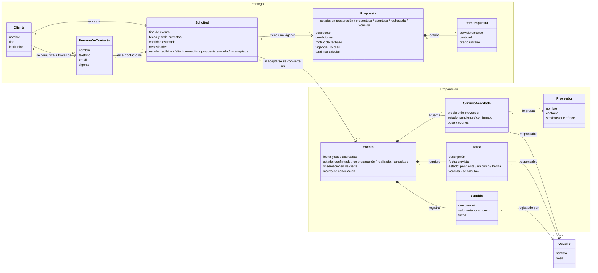

# Documento final — Sistemas de Información

**Trabajo práctico integrador · Sistema de gestión de eventos para una empresa organizadora**

| | |
|---|---|
| **Integrantes** | Máximo Bertaina · Tomi Carle · Facu Trobbiani · Lucas _(completar nombres y apellidos)_ |
| **Organización de referencia** | Empresa que organiza eventos para centros de estudiantes |
| **Versión del documento** | 1 · 22/10/2026 |
| **Software al que corresponde** | v2.0.1 (repositorios `intermaterias-backend`, `intermaterias-frontend`, `intermaterias-infra`) |

---

## 1. Introducción

### 1.1 Objetivo

Este documento integra el **relevamiento**, el **análisis del sistema organizacional**, el **análisis del
sistema de información** y el **diseño conceptual orientado al dominio** de la solución desarrollada.
También muestra cómo evolucionó el análisis y en qué medida el software responde a las necesidades
relevadas.

El objetivo del software, tomado de la consigna común, es **facilitar la gestión y el seguimiento de los
eventos encargados por los clientes**, para que el personal de la organizadora sepa **qué se acordó, quién
debe hacer qué y qué falta resolver**. El cliente lo expresó con las mismas palabras: su problema central
es que "cada integrante sepa qué se acordó con el cliente, qué tiene que hacer y qué está pendiente" [M].

### 1.2 Organización de referencia

El grupo trabajó para una **empresa organizadora de eventos especializada en centros de estudiantes**:
fiestas de bienvenida, de egresados y aniversarios. El **centro de estudiantes es su cliente**, no quien
organiza (ver la evolución en la sección 7).

El análisis corresponde a **una sola organizadora**, como pide la consigna. El software admite varias
empresas (multitenant) porque lo exigen otras materias; eso no cambia el análisis, que describe el
funcionamiento relevado de una única empresa.

### 1.3 Fuentes y convención de evidencia

Todo lo que se presenta como funcionamiento de la empresa sale de las conversaciones con el cliente
(el proyecto de ChatGPT provisto por el docente). Cada afirmación lleva su fuente:

| Marca | Fuente |
|---|---|
| **[M]** | [Conversación de masita: clientes, solicitudes y cierre](relevamiento/conversaciones/2026-10-14-masita-clientes.md) (14/10) |
| **[T]** | [Conversación de Tomi: propuesta y confirmación](relevamiento/conversaciones/2026-10-14-tomi-propuesta.md) (14/10) |
| **[F1]** | [Conversación de Facu: servicios y proveedores, ronda 1](relevamiento/conversaciones/2026-10-14-facu-servicio-proveedores.md) (14/10) |
| **[F2]** | [Conversación de Facu: servicios y proveedores, ronda 2](relevamiento/conversaciones/2026-10-22-facu-servicio-proveedores-ronda2.md) (22/10) |
| **[A]** | Documento común "Objetivo y alcance del software" |
| **(G)** | **Decisión del grupo**: no surge del cliente; se tomó para poder desarrollar y queda pendiente de validar |
| **(H)** | **Hipótesis**: interpretación todavía no confirmada |

El análisis detallado de cada parte está en documentos de trabajo que este documento consolida:
[sistema organizacional](01-sistema-organizacional.md), [sistema de información](02-sistema-de-informacion.md),
[dominio](03-dominio.md) y [relevamiento por área](relevamiento/README.md).

---

## 2. Relevamiento

### 2.1 Cómo se hizo

El relevamiento se repartió por áreas del alcance. Para cada una, el responsable:

1. Definió **qué necesitaba averiguar** y preparó preguntas guía en el archivo de su área.
2. Conversó con el cliente **repreguntando** ("¿quién hace eso?", "¿qué pasa si…?", "¿siempre es así?") y pidiendo ejemplos concretos.
3. **Validó** sus interpretaciones ("Entonces, si entiendo bien… ¿es así?").
4. Guardó la conversación completa y separó lo **confirmado** de las **hipótesis**.

### 2.2 Rondas realizadas

| Área | Responsable | Ronda 1 | Ronda 2 | Estado |
|---|---|---|---|---|
| Clientes, solicitudes, consulta y cierre | masita | 14/10 [M] | — | Conversación hecha; quedan preguntas abiertas (cursos, cierre) |
| Propuesta, presupuesto y confirmación | Tomi | 14/10 [T] | — | Conversación hecha; queda abierto el tema de los paquetes |
| Servicios y proveedores | Facu | 14/10 [F1] | 22/10 [F2] | Completa |
| Preparación, seguimiento, cambios y cancelaciones | Lucas | **No realizada** | — | **Pendiente** (ver sección 9) |

### 2.3 Lo que confirmó el cliente

| Tema | Lo confirmado | Fuente |
|---|---|---|
| Quién organiza | Una **empresa**; el **centro de estudiantes es el cliente** | [M] |
| Quién usa el sistema | Solo el personal de la empresa; **una persona puede tener varios roles** | [M] |
| Cliente y contacto | El cliente se comunica a través de una **persona de contacto que puede cambiar** sin que cambie el cliente | [M] |
| Problemas actuales | La información llega por distintos medios y queda **dispersa**; datos de contacto desactualizados demoran decisiones; pedidos que quedan sin respuesta | [M] |
| Propuesta | Detalla **cada servicio con su importe**; el total es la suma; **descuentos puntuales** a mano; los **paquetes** son un punto de partida | [T] |
| Confirmación | **Aceptación expresa** del cliente, registrada por la empresa; **sin seña** ni firma | [T] |
| Vigencia | La propuesta **vence a los 15 días** corridos; vencer no elimina la solicitud y se puede renegociar | [T] |
| Rechazo | Se registra el motivo **si lo da**; se puede renegociar | [T] |
| Antes de aceptar | **No se coordinan proveedores ni tareas** hasta que la propuesta está aceptada | [M] |
| Cambios relevantes | Se registran y el personal **revisa a mano** los compromisos afectados | [M] [T] |
| Servicios | Algunos los presta un **proveedor** y otros el **equipo propio**, siempre con un responsable | [F1] |
| Proveedores | **Contactado no es confirmado**; se registra resultado, condiciones, pendientes y quién sigue el tema | [F1] |
| Confirmación del proveedor | Confirmado = **respuesta afirmativa clara** en la fecha y condiciones acordadas; si faltan datos, sigue pendiente | [F2] |
| Baja y reemplazo | Si un proveedor no está disponible o se baja, se registra y se busca **reemplazo**; se conserva **quién estaba previsto** | [F2] |
| Estados del proveedor | El cliente necesita distinguir **pendiente, confirmado, no disponible y reemplazado** | [F2] |

### 2.4 Lo que no se confirmó

| Tema | Situación | Cómo se resolvió en el software |
|---|---|---|
| ¿El cliente puede ser un **curso**? | El cliente se contradijo: habló del centro como cliente y también del curso [M] | El cliente se registra con un **tipo**; el análisis lo trata como el centro de estudiantes (G) |
| ¿Sirven los **cursos** para organizar? | Sin respuesta | Existen en la base pero **no se usan** en ninguna pantalla (G) |
| Estados de las **tareas** y qué es una tarea vencida | No hubo conversación de seguimiento | `pendiente` → `en_curso` → `hecha`; vencida = no hecha con fecha pasada (G) |
| **Cancelación**: quién decide, qué se conserva | El cliente solo dijo que el seguimiento llega hasta que el evento "se realiza o se cancela" [M] | Motivo obligatorio y se conserva toda la información, como pide el alcance [A] (G) |
| ¿Hace falta guardar los **paquetes**? | Sin respuesta [T] | No se guardan: la propuesta detalla los servicios (G) |

---

## 3. Análisis del sistema organizacional

El detalle, con la fuente de cada afirmación, está en [01-sistema-organizacional.md](01-sistema-organizacional.md).

### 3.1 Sistema observado, propósito y límite

El sistema observado es el **trabajo de la organizadora para atender un encargo**: recibir la solicitud,
preparar y presentar una propuesta y, si el cliente la acepta, organizar el evento hasta su realización o
cancelación [M]. Su **propósito** es que cada integrante conozca qué se acordó, qué debe hacer y qué sigue
pendiente [M].

El **límite** comprende las actividades de la organizadora que intervienen en ese recorrido. El cliente, la
persona de contacto, los proveedores y la institución educativa quedan en el **entorno**: se comunican con
la organizadora por fuera del software (WhatsApp, llamadas, reuniones, correo) y el resultado se registra
internamente [M] [F1].

### 3.2 Actores

| Actor | Rol | Interno / externo |
|---|---|---|
| Atención al cliente | Recibe la solicitud y registra sus datos | Interno [M] |
| Responsable de la propuesta | Prepara la propuesta, negocia y registra la aceptación o el rechazo | Interno [M] [T] |
| Responsable de organización | Con el evento confirmado, coordina servicios y proveedores y organiza las tareas | Interno [M] |
| Integrante del equipo | Hace las tareas asignadas; puede coordinar un servicio y contactar a un proveedor | Interno [M] [F1] |
| Cliente (centro de estudiantes) | Encarga el evento y acepta o rechaza la propuesta | Externo [M] |
| Persona de contacto | Se comunica en nombre del cliente; puede cambiar | Externo [M] |
| Proveedor | Presta un servicio externo; confirma o no su participación | Externo [F1] |
| Institución educativa | Puede intervenir (por ejemplo, prestando la sede), pero no contrata | Externo [M] |

### 3.3 Entradas, procesos y salidas

| Entrada | Proceso | Salida |
|---|---|---|
| Pedido del cliente | Registrar la solicitud y aclarar los datos que falten [M] | Solicitud lista para proponer |
| Solicitud y necesidades | Armar la propuesta, a veces partiendo de un paquete [T] | Propuesta con servicios, importes y total |
| Respuesta del cliente | Registrar la aceptación expresa o el rechazo [T] | Evento confirmado, o propuesta rechazada (renegociable) |
| Evento confirmado | Coordinar proveedores y equipo propio; asignar tareas [M] [F1] | Servicios pendientes o confirmados; tareas con responsable |
| Cambio de fecha, sede o servicio | Registrar el cambio y revisar a mano los compromisos [M] [T] | Compromisos revisados |
| Evento que termina o se cancela | Registrar la realización o la cancelación [M] | Evento cerrado con observaciones o motivo |

### 3.4 Subsistemas

Es una **lectura analítica** del recorrido, no una estructura formal de la empresa:

- **Encargo**: solicitud, propuesta, aceptación o rechazo. Su salida, la aceptación, habilita al siguiente.
- **Preparación**: servicios acordados, proveedores, tareas, pendientes y cambios.
- **Organización y acceso**: personal, roles y registro compartido que da soporte a los dos anteriores.

### 3.5 Restricciones, bucles y demoras

- **Restricción central:** no se coordinan proveedores ni tareas antes de la aceptación [M].
- **Bucle de renegociación:** una propuesta rechazada o vencida se ajusta y se vuelve a presentar [T].
- **Bucle de revisión:** un cambio relevante obliga a revisar los compromisos ya acordados [M] [T].
- **Bucle de reemplazo:** un proveedor que se baja devuelve el servicio a pendiente hasta que confirma su reemplazo [F2].
- **Demora:** la propuesta espera la respuesta del cliente hasta **15 días**; después vence [T].
- **Demora:** la participación de un proveedor queda pendiente hasta una confirmación clara [F2].

---

## 4. Análisis del sistema de información

El detalle está en [02-sistema-de-informacion.md](02-sistema-de-informacion.md).

### 4.1 Información por actividad

| Actividad | Información | Produce | Registra o modifica | Consulta y para qué |
|---|---|---|---|---|
| Recibir la solicitud | Cliente, contacto, tipo de evento, fecha y sede previstas, cantidad estimada, necesidades | Cliente | Atención al cliente | Equipo, para preparar la propuesta (**operar**) |
| Preparar la propuesta | Servicios, cantidades, importes, descuento, condiciones, vencimiento | Responsable de la propuesta | Responsable de la propuesta | Cliente y personal, para decidir (**decidir**) |
| Confirmar o rechazar | Decisión, fecha, motivo de rechazo | Cliente | Responsable de la propuesta | Organización, para saber si hay un compromiso (**operar**) |
| Coordinar servicios | Proveedor o equipo propio, responsable, estado, observaciones | Proveedor y coordinador | Responsable de organización o integrante | Equipo, para saber qué falta confirmar (**controlar**) |
| Preparar el evento | Tareas, responsables, fechas previstas, estados | Equipo | Responsable de organización o integrante | Equipo, para ver lo pendiente o vencido (**controlar**) |
| Registrar un cambio | Qué cambió, valor anterior y nuevo, quién y cuándo | Cliente o personal | Personal autorizado | Equipo, para revisar compromisos (**controlar**) |
| Cerrar o cancelar | Estado final, observaciones o motivo | Personal | Responsable de organización o atención al cliente | Equipo, para consultar el historial (**decidir**) |

### 4.2 Fuentes, canales y destinatarios

| Información | Fuente | Canal | Destinatarios |
|---|---|---|---|
| Pedido y datos del evento | Cliente o su contacto | Por fuera del software; se registra en el sistema | Atención al cliente, propuesta y organización |
| Propuesta | Responsable de la propuesta | Registro interno; se presenta al cliente por fuera | Cliente y equipo |
| Disponibilidad del proveedor | Proveedor | Teléfono, WhatsApp o correo [F1] | Coordinador y equipo, mediante el registro |
| Avance de tareas y cambios | Equipo | Registro interno | Responsables del evento |

### 4.3 Calidad de la información

| Problema relevado o previsible | Control en el software |
|---|---|
| Información dispersa en distintos medios [M] | Un único registro por evento con la propuesta, los servicios, las tareas y el historial de cambios |
| Pedidos que quedan sin respuesta [M] | Estados del evento y pantalla de **Pendientes** |
| Datos de contacto desactualizados [M] | Contactos separados del cliente, con uno **vigente** |
| Total de la propuesta mal calculado | El total **se calcula** a partir de los ítems; no se carga a mano |
| Confundir contactado con confirmado [F1] | El servicio queda `pendiente` hasta que alguien lo **confirma**; para confirmar hace falta un proveedor que ofrezca ese servicio |
| Preparar algo que el cliente no aceptó [M] | No se pueden cargar servicios ni tareas en un evento sin confirmar |
| Perder el motivo de una cancelación | El motivo es **obligatorio** y la información del evento se conserva |
| Editar un evento ya cerrado | Un evento realizado o cancelado no se puede editar ni cancelar |
| Acceso indebido | Cada persona entra con su usuario y solo puede hacer lo que permite su rol |

### 4.4 Qué soporta el software y qué queda afuera

**Dentro del software:** el registro de clientes, contactos y solicitudes; la propuesta con su total; la
aceptación o el rechazo; los servicios acordados con su proveedor o responsable; las tareas; los
pendientes; el historial de cambios; la consulta por fecha o estado y el cierre o la cancelación.

**Fuera del software, y cómo se relaciona:** las conversaciones con clientes y proveedores, las consultas de
disponibilidad y la negociación ocurren por los medios habituales de la empresa. El software **no las
reemplaza ni se integra con ellos**: el personal registra el resultado [A] [F1]. Tampoco hay firma digital,
facturación, cobros, reservas automáticas ni portales para clientes o proveedores [A].

---

## 5. Análisis y diseño orientado al dominio

El detalle (glosario completo, reglas y versiones del modelo) está en [03-dominio.md](03-dominio.md).

### 5.1 Lenguaje ubicuo

| Término | Significado | No confundir con |
|---|---|---|
| **Organizadora** | La empresa que organiza eventos; sus integrantes son los únicos usuarios | Centro de estudiantes |
| **Cliente** | Quien encarga el evento: el centro de estudiantes | Persona de contacto, institución |
| **Persona de contacto** | Quien se comunica en nombre del cliente; puede cambiar | Cliente |
| **Solicitud** | El pedido antes de aceptar la propuesta. La empresa también le dice "pedido" | Evento confirmado |
| **Propuesta** | Servicios ofrecidos con su importe y el total; una sola vigente por solicitud | Paquete |
| **Paquete** | Combinación habitual de servicios usada como punto de partida | Propuesta |
| **Servicio acordado** | Un servicio incluido en la propuesta aceptada: un compromiso a cumplir | Servicio ofrecido |
| **Servicio propio** | Un servicio que hace el equipo, con un responsable interno | Servicio de proveedor |
| **Participación del proveedor** | El vínculo de un proveedor con un servicio acordado, con su estado | Contacto con el proveedor |
| **Evento** | La solicitud después de aceptada la propuesta | Solicitud |
| **Cambio relevante** | Modificación de fecha, sede, cantidad o servicios después de confirmar | Ajuste durante la negociación |
| **Rechazada / cancelado** | *Rechazada* es una propuesta (renegociable); *cancelado* es un evento ya confirmado | — |

### 5.2 Estados (tal como quedaron en el software)

| Concepto | Estados | Origen |
|---|---|---|
| Solicitud / evento | `recibida`, `falta_informacion`, `propuesta_enviada`, `confirmado`, `en_preparacion`, `realizado`, `no_aceptada`, `cancelado` | [M] [T]; `en_preparacion` (G) |
| Propuesta | `en_preparacion`, `presentada`, `aceptada`, `rechazada`, `vencida` | [T] |
| Servicio acordado | `pendiente`, `confirmado` | [F1]; faltan `no disponible` y `reemplazado` [F2] (sección 8) |
| Tarea | `pendiente`, `en_curso`, `hecha` (vencida se calcula) | (G) |

### 5.3 Reglas de negocio y cómo las valida el software

| # | Regla | Fuente | Validación en el software |
|---|---|---|---|
| R1 | No se coordinan proveedores ni tareas antes de la aceptación | [M] | Servicios y tareas solo en eventos `confirmado` o `en_preparacion` |
| R2 | Una sola propuesta vigente por solicitud | [T] [A] | Una propuesta por evento |
| R3 | La propuesta detalla cada servicio; el total es la suma | [T] | Total calculado: suma de ítems menos el descuento |
| R4 | Descuentos puntuales, definidos a mano | [T] | Campo de descuento sobre el total |
| R5 | Confirma la aceptación expresa, sin seña | [T] | Botón "Aceptar" con fecha; sin datos de pago |
| R6 | Al aceptar quedan los servicios acordados | [T] | Al aceptar, cada ítem pasa a ser un servicio acordado |
| R7 | La propuesta vence a los 15 días | [T] | Pasa a `vencida`; aparece en Pendientes en su última semana |
| R8 | El rechazo registra el motivo si lo hay; se puede renegociar | [T] | Motivo opcional; se puede volver a presentar |
| R9 | Los cambios relevantes se registran y se revisan a mano | [M] [T] | Historial automático de fecha, sede y cantidad en eventos confirmados |
| R10 | Contactado no es confirmado | [F1] | Estado `pendiente` hasta confirmar |
| R11 | Un servicio propio no tiene proveedor pero sí responsable | [F1] | Proveedor opcional y responsable |
| R12 | Si cambia el contacto, el cliente es el mismo | [M] | Contactos separados del cliente, uno vigente |
| R13 | La cancelación conserva la información y el motivo | [A] | Motivo obligatorio; nada se borra (G en los detalles) |
| R14 | Un evento cerrado no se modifica | (G) | No se edita un evento realizado o cancelado; no se cancela uno realizado |

### 5.4 Subdominios

| Subdominio | Tipo | Justificación |
|---|---|---|
| **Acuerdo del encargo** (solicitud, propuesta, aceptación) | Core | Es donde la empresa se diferencia y donde están sus problemas: pedidos sin respuesta y datos dispersos [M] |
| **Coordinación de la preparación** (servicios acordados, proveedores, tareas, cambios) | Core | Es la otra mitad del objetivo; si se pierde un compromiso, el evento falla [F1] |
| **Catálogos** (tipos de evento, sedes, servicios, proveedores) | Soporte | Se consultan para trabajar, pero no diferencian a la empresa |
| **Acceso del personal** (usuarios y roles) | Genérico | Lo necesita cualquier sistema |

### 5.5 Bounded contexts

| Contexto | Conceptos | Quién trabaja ahí | Pregunta que responde |
|---|---|---|---|
| **Encargo** | Cliente, persona de contacto, solicitud, propuesta, ítem | Atención al cliente, responsable de la propuesta | ¿Qué pidió el cliente y qué le ofrecimos? |
| **Preparación** | Evento, servicio acordado, proveedor, tarea, cambio | Responsable de organización, integrantes | ¿Quién hace qué, qué está confirmado y qué falta? |
| Organización y acceso | Usuario, rol, catálogos | Todos | ¿Quién usa el sistema y con qué datos base? |

**Por qué se separan Encargo y Preparación:**

1. **"Servicio" cambia de significado.** En Encargo es algo **ofrecido con un importe** [T]; en Preparación es un **compromiso** que cumple un proveedor o el equipo, con un responsable [F1].
2. **La solicitud se convierte en evento.** Antes de aceptar puede cambiar, rechazarse, renegociarse o vencer [T]; después es un compromiso que se ejecuta.
3. **Las reglas son distintas.** Encargo: una propuesta vigente, total calculado, 15 días de vigencia [T]. Preparación: contactado no es confirmado, responsables y tareas [F1].
4. **Trabajan personas distintas** [M] [T].

La **aceptación** es el punto de paso: Encargo le entrega a Preparación la fecha, la sede, los servicios
aceptados y las condiciones [T]. Los contextos son una forma de **entender el dominio**; en el software
comparten una única base de datos.

### 5.6 Modelo conceptual (versión final)

**Cambios respecto de la versión 1 del modelo:** se quitó **Curso**, porque el cliente no confirmó que sirva
para organizar y el software no lo usa; los estados de la **tarea** quedaron definidos (G); el ítem de la
propuesta tiene **precio unitario** y cantidad.

**Relación con la base de datos:** `Solicitud` y `Evento` son la misma tabla (`eventos`) con distinto estado,
porque es el mismo encargo que avanza; en el modelo se separan para mostrar que **cambia de significado** al
aceptarse. `PersonaDeContacto` es la tabla `contactos`, `ServicioAcordado` es `evento_servicios` y los roles
están en `usuario_roles`.

---

## 6. Correspondencia entre necesidades, modelo y solución

| Necesidad del alcance [A] | Concepto | En el software | Estado |
|---|---|---|---|
| Registrar el cliente y su solicitud | Cliente, persona de contacto, solicitud | Pantallas *Clientes* y *Nueva solicitud* | Cumple |
| Propuesta con servicios, importes y total; aceptación o rechazo | Propuesta, ítem | Pestaña *Propuesta* del evento | Cumple |
| Confirmación del encargo con servicios y condiciones | Aceptación, servicio acordado | Botón *Aceptar*: crea los servicios acordados | Cumple |
| Proveedores vinculados, pendiente o confirmado | Servicio acordado, proveedor | Pestaña *Servicios* y catálogo de proveedores | Cumple; falta *no disponible* / *reemplazado* [F2] |
| Tareas con responsable, fecha y estado; pendientes | Tarea | *Tareas* y *Pendientes* | Cumple; estados no validados con el cliente (G) |
| Consulta por fecha o estado, resumen y cierre | Evento | *Solicitudes y eventos* con filtros; detalle; *Cerrar evento* | Cumple |
| Cambios relevantes y revisión de compromisos | Cambio | Pestaña *Cambios* (fecha, sede, cantidad) | Parcial: los cambios de un servicio acordado no quedan en el historial |
| Cancelación con motivo, conservando la información | Evento cancelado | *Cancelar evento* con motivo obligatorio | Cumple |
| Acceso identificado con permisos sencillos | Usuario, rol | Login con usuario y contraseña; los 4 roles relevados (el de administrador de la empresa es parte de la extensión de la sección 10) | Cumple |

El software permite demostrar el recorrido completo que pide la consigna: una solicitud, su propuesta, la
aceptación, la coordinación de servicios y tareas, la consulta de pendientes y el cierre, además de una
**propuesta rechazada**, un **cambio relevante** y una **cancelación**.

---

## 7. Evolución del análisis

| Fecha | Qué cambió | Por qué |
|---|---|---|
| 13/10 | Primera comprensión desde el alcance: dos contextos, Encargo y Preparación | Todavía no había relevamiento |
| 14/10 | **La organizadora es una empresa y el centro de estudiantes es su cliente** (antes creíamos que organizaba el centro) | Lo aclaró el cliente [M] |
| 14/10 | Primer lenguaje ubicuo, estados y reglas acordados por el grupo | Ronda 1 de las tres áreas [M] [T] [F1] |
| 15/10 | Se confirma la separación Encargo / Preparación; aparecen persona de contacto, roles, servicio propio y vencimiento | "No coordinamos proveedores ni tareas hasta tener la propuesta aceptada" [M]; [T]; [F1] |
| 15–16/10 | Base de datos ajustada: contactos separados, varios roles por persona, servicio propio con responsable | Relevamiento ronda 1 |
| 20/10 | Un evento en `falta_informacion` quedaba trabado: se permite presentar la propuesta desde ese estado | Problema encontrado al probar el recorrido completo |
| 20/10 | No se puede cancelar un evento realizado ni editar uno cerrado (R14) | Problema encontrado al probar el recorrido (G) |
| 22/10 | Ronda 2 de proveedores: confirmación, baja, reemplazo y los estados que necesita el cliente | [F2]; detectó una diferencia con el software (sección 8) |
| 22/10 | El modelo conceptual quita *Curso* y fija los estados de la tarea | Sin confirmación del cliente sobre cursos; necesidad de desarrollar |

**Devoluciones del docente:** en las entregas de avance **no se recibieron devoluciones formales**. La
revisión del análisis surgió de las respuestas del cliente y de los problemas encontrados al desarrollar y
probar el software, como muestra la tabla.

---

## 8. Diferencias pendientes entre lo relevado y lo desarrollado

| Diferencia | Lo que pide el cliente | Lo que hace hoy el software | Próximo paso |
|---|---|---|---|
| Estados del proveedor | Distinguir pendiente, confirmado, **no disponible** y **reemplazado**, conservando el proveedor original [F2] | Solo `pendiente` y `confirmado`; la baja o el reemplazo quedan en observaciones | Versión 2.1.0 |
| Cambio de un servicio acordado | Registrar los cambios relevantes, incluidos los de servicios [A] [T] | El historial registra fecha, sede y cantidad, no los cambios de servicio | Sumar al historial |
| Seguimiento y cancelación | Validar estados de tareas, quién cancela y qué pasa con proveedores y tareas | Decisiones del grupo (G) | Conversación pendiente (sección 9) |

---

## 9. Pendientes antes de la entrega

- [ ] **Conversación de seguimiento, cambios y cancelaciones** (Lucas), con las preguntas de
      [seguimiento-cambios.md](relevamiento/seguimiento-cambios.md). Con las respuestas se actualizan las
      secciones 2.4, 5.2 y 8.
- [ ] Completar las tablas de **confirmado por el cliente** de [clientes](relevamiento/clientes-solicitudes-cierre.md)
      y [propuesta](relevamiento/propuesta-confirmacion.md) con lo que ya está en las conversaciones.
- [ ] Repasar el documento entre los cuatro: **todos tienen que poder explicar cada decisión**.

---

## 10. Extensiones del software fuera del análisis de SI

El software v2 incluye dos funciones que **no forman parte de este análisis**:

- **Varias empresas en el mismo sistema** (super admin y administrador por empresa). La exigen otras
  materias. La consigna aclara que, en ese caso, el análisis de SI sigue correspondiendo a una única
  organización.
- **Invitados con confirmación y pago**: un link público por evento donde cada invitado responde si va, el
  medio de pago y, si transfiere, el comprobante. Fue una **decisión del grupo** y **excede el alcance común**,
  que deja afuera la gestión individual de invitados, los cobros y los portales [A]. **No surgió del
  relevamiento ni se validó con el cliente**; si se mantuviera, habría que relevarla como cualquier otra área.

---

## Fuentes

- Conversaciones: [masita, clientes](relevamiento/conversaciones/2026-10-14-masita-clientes.md) ·
  [Tomi, propuesta](relevamiento/conversaciones/2026-10-14-tomi-propuesta.md) ·
  [Facu, proveedores ronda 1](relevamiento/conversaciones/2026-10-14-facu-servicio-proveedores.md) ·
  [Facu, proveedores ronda 2](relevamiento/conversaciones/2026-10-22-facu-servicio-proveedores-ronda2.md)
- Documentos de trabajo: [sistema organizacional](01-sistema-organizacional.md) ·
  [sistema de información](02-sistema-de-informacion.md) · [dominio](03-dominio.md) ·
  [relevamiento por área](relevamiento/README.md)
- Base de datos: [entidades](https://github.com/maxibertaina03/intermaterias-backend/blob/develop/database/entidades.md) ·
  [DER](https://github.com/maxibertaina03/intermaterias-backend/blob/develop/database/der.png) ·
  [modelo lógico](https://github.com/maxibertaina03/intermaterias-backend/blob/develop/database/modelo-logico.png)
- Consigna: "Trabajo práctico integrador — Sistemas de Información" y "Objetivo y alcance del software"
